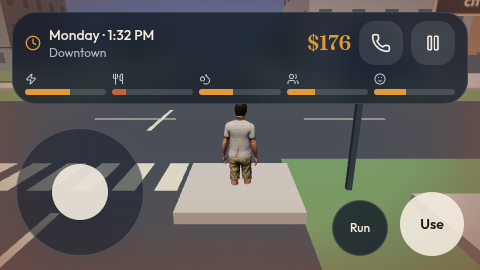

# Daybreak Row

**A mobile-first, 3D neighborhood and city life-simulation game.** Explore a coastal neighborhood and its connected city, meet residents, enter businesses, earn money, manage daily needs, and discover new places.

> **Status:** Active development. This is a browser game, not an Android APK. Repository visibility is controlled by its owner.



*In-game capture from the updated city build (October 2026; software-rendered QA browser).*

Additional current captures: [Old Town Bakery exterior](screenshots/bakery-current.jpg) · [Corner Books interior](screenshots/bookshop-current.jpg).

## What you can do

- **Explore five connected districts:** Daybreak Row, Old Town, Civic Quarter, Downtown, and Arts & Station.
- **Enter eight interiors:** your apartment, Harbor Cafe, Cho's Market, Northline Office, Old Town Bakery, Civic Fitness, Metro Cinema, and Corner Books.
- **Live a daily routine:** shop, eat, work, exercise, read, see a movie, and manage money, energy, hunger, hygiene, fun, and social needs.
- **Meet residents:** named characters follow scheduled routines and offer conversations; the in-game phone's **People** tab shows their current whereabouts.
- **Complete city activities:** use the **City** phone tab to view districts and transit, stamp three destinations on the daily City Passport, then claim a reward at City Hall.
- **Discover districts:** earn one-time exploration rewards for visiting new neighborhoods.
- **Travel around town:** explore on foot or use the paid in-game transit stops.
- **Enjoy a consistent daytime world:** the scene remains sunlit even while the simulation clock, schedules, and daily systems continue advancing.

The city includes moving ambient vehicles, walking pedestrians, parks and plazas, storefronts, environmental props, and locally bundled character, vehicle, and environment models. Not every building can be entered; some locations are exterior-only interactions or scenery.

## Play on Android (Termux)

The current local setup is configured for a **Pixel 6a running Termux**.

1. Open Termux.
2. Start the local server:

   ```sh
   cd ~/MainWorkspace/daybreak-row
   ./start-local.sh
   ```

3. Open **http://127.0.0.1:4186/** in Chrome on the same device.

The launcher starts the server in the background or reports the existing server. If Android suspends Termux and the page stops loading, run the launcher again. Keep Termux running while playing.

**Your saved game is stored locally in the browser for that origin.** Avoid clearing Chrome site data for `127.0.0.1:4186` unless you intend to lose that progress. Saves are not automatically synchronized through GitHub or between devices.

For additional device-specific details, see [README-LOCAL.md](README-LOCAL.md).

## Controls

### Touchscreen

| Action | Control |
| --- | --- |
| Walk / strafe | Drag the lower-left virtual joystick |
| Sprint | Hold **Run** with a second finger while moving |
| Look around | Drag the open world with another finger |
| Interact / enter / exit | Tap **Use** when the nearby action appears |
| City map, people, activities | Open the in-game **Phone** |
| Daily settings | Use the in-game pause and phone menus |

The input system releases held controls when the tab loses focus or a touch is canceled to reduce stuck movement. Keyboard support is also present for desktop testing.

## Develop locally

**Requirements:** Node.js and npm. Node.js **24.18.0** is verified on the owner's Termux device (October 17, 2026); the older scaffold originally assumed Node 22. Other environments need their own validation.

```sh
git clone https://github.com/EchoEe247/daybreak-row.git
cd daybreak-row
npm ci
npm run dev
```

The default development server runs at **http://localhost:8080/**. The Android-specific `start-local.sh` instead selects port **4186**.

Other useful commands:

```sh
npm run test:game         # Gameplay, city, interiors, controls, and assets
npm run test:mobile-controls
npm run typecheck
npm run build
npm run lint
```

**Validation snapshot (October 17, 2026):** 39/39 gameplay tests, typecheck, and production build pass. The broader `npm test` script has existing scaffold/PWA branding fixture failures and `npm run lint` reports two existing findings. See [Runtime and QA](docs/handoff/RUNTIME-AND-QA.md) before interpreting results.

## Tech and organization

- **Rendering:** Three.js and GLTF/GLB assets
- **UI and application:** React, TypeScript, TanStack Start / Router, and Vite
- **Mobile focus:** reduced render cost, lower-quality mobile shadows, optimized vegetation and vehicle models
- **Persistence:** browser-local version-1 save format, with backward-compatible optional fields

| Path | Purpose |
| --- | --- |
| `src/game/` | Game world, interactions, player/NPC systems, and gameplay tests |
| `src/components/` and `src/routes/` | Interface and application routes |
| `public/environment/` | Environment models and textures |
| `public/humans/` | Rigged character assets, animations, and license notice |
| `assets/` | Asset provenance and source records |
| `scripts/` | Development, preview, and validation scripts |
| `screenshots/` | Captured game and control screenshots |

## For outside researchers and AI collaborators

This repository is self-contained for source and documentation research but **does not expose the owner's live phone or local server**. Read [CLAUDE.md](CLAUDE.md), [current game state](docs/handoff/CURRENT-STATE.md), [runtime and QA](docs/handoff/RUNTIME-AND-QA.md), and [shipped asset inventory](docs/handoff/ASSET-BASELINE.md). Claude's structured assignment and deliverables live under [docs/claude/](docs/claude/README.md). For sharing with an external assistant, use the [copy-ready Claude prompt](docs/claude/PROMPT-FOR-CLAUDE.md) and review the [temporary public-access checklist](docs/handoff/TEMPORARY-PUBLIC-ACCESS.md).

The [screenshot guide](screenshots/README.md) distinguishes current game captures from outdated previews.

## Development notes

The project started from a Grok Build export and was adapted for local Android/Termux play, with subsequent city, interior, control, NPC, and environment upgrades.

Project-specific design and implementation notes:

- [Connected city and daily activities](CITY-EXPANSION.md)
- [Cinema, bookshop, and resident routines](NEIGHBORHOOD-LIFE-UPDATE.md)
- [Environment asset details](ENVIRONMENT-ASSETS.md)
- [Street and tree improvements](STREET-ASSETS.md)
- [Human assets and attribution](HUMAN-ASSETS.md)

**Current limitations:** Real-device touch comfort, sustained frame rate, and battery usage still need dedicated testing on the physical phone. Browser-based render checks are not a substitute for that testing. City interiors and NPC behavior remain works in progress.

## Assets, attribution, and access

The project currently has **no general open-source license for its original code or art**. Even if the owner temporarily makes the repository public for research, public visibility **does not** grant unrestricted reuse or remove third-party attribution requirements. Third-party assets retain their respective licenses. In particular:

- Environmental and street assets documented in the manifests/provenance files are sourced under **CC0**.
- Human rigs and animations include **MIT-licensed Microsoft assets**; preserve the notice in `public/humans/LICENSE-Microsoft-MIT.txt` if distributing them.
- Consult the detailed provenance files before redistributing any asset.

---

*Daybreak Row — a growing city, one neighborhood at a time.*